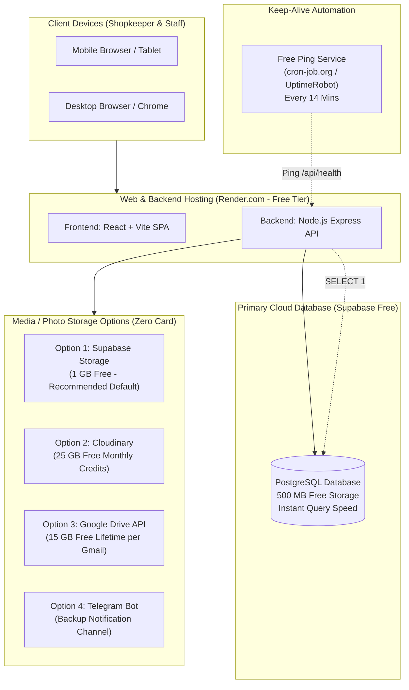
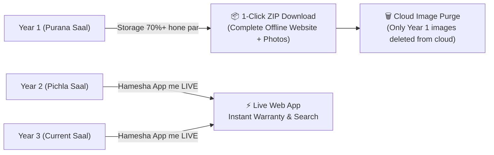

# 🚀 PHONEZONE - 100% LIFETIME FREE WEB HOSTING ARCHITECTURE GUIDE
> **Zero Credit Card Required • Render.com • Supabase • Cloudinary / GDrive • Smart 2-3 Year Offline Archiving**

---

## 📌 1. Overview & Vision (Humara Target)

Yeh document PhoneZone ko local desktop / offline software se **100% Free Lifetime Web Application** me convert karne ka complete roadmap aur architecture blueprint hai.

### Key Objectives:
1. **Zero Recurring Cost**: Shopkeeper ko ₹1 bhi monthly ya yearly subscription nahi dena padega.
2. **Zero Card Verification**: Kisi bhi platform par International Credit Card ya Debit Card OTP verification mandatory **nahi** hoga (Indian small shopkeepers ke liye no-friction onboarding).
3. **High Reliability & Speed**: Bills, stock search, aur customer receipts instant 1-second me open honge.
4. **Smart Storage Lifecycle**: 1 GB free cloud storage kabhi expire ya full nahi hogi, kyunki humara **Rolling 2-3 Year FIFO Archiving** purani images ko offline ZIP me save karke cloud ko clean rakhega.

---

## 🏗️ 2. Web Version Architecture Diagram

---

## 💳 3. Zero Credit Card Verification (Kyun & Kaise?)

### Problem with Major Clouds:
- **AWS S3, Cloudflare R2, Google Cloud Platform (GCP), Oracle Cloud**:
  - In sabhi services me account activate karte hi **International Credit Card** maangte hain.
  - Indian shopkeepers ke Rupay cards, domestic debit cards reject ho jate hain, ya bank OTP blocking issues aate hain.

### Humara Solution (100% No Card Required):
| Service | Free Tier Limit | Card Required? | Setup Difficulty | Best For |
| :--- | :--- | :--- | :--- | :--- |
| **Supabase (Storage & DB)** | 500 MB DB + 1 GB Storage | ❌ **KABHI NAHI** (Sirf Email OTP) | ⭐ Very Easy (1-Click) | **Default Recommendation** |
| **Cloudinary** | 25 GB Credits/Month (~25,000 photos) | ❌ **NO CARD** (Email Signup) | ⭐ Easy (API Key + Secret) | **Ultra Fast Global CDN** |
| **Google Drive** | 15 GB Free Lifetime | ❌ **NO CARD** (Normal Gmail Account) | ⭐⭐ Moderate (OAuth/Service Account) | **High Volume Storage** |
| **Render.com** | 750 Free Hours/Month | ❌ **NO CARD** (GitHub/Email login) | ⭐ Very Easy | **App & Backend Hosting** |

---

## 📊 4. Storage Math: 1 GB Kitne Saal Chalega?

Bahut se logon ko lagta hai ki 1 GB jaldi bhar jayega, lekin smart optimization se yeh **3 se 4 saal** aaram se chalega:

### Optimization Rules:
1. **Frontend WebP Auto-Compression**: Jab shopkeeper phone ya bill ki photo camera se kheenchega (jo 3MB - 5MB ki hoti hai), frontend usko upload hone se pehle **800px × 800px WebP** format me convert karega.
2. **File Size Per Image**: Average **80 KB se 120 KB** (Crystal clear visible text aur phone condition).
3. **Average Photos per Phone**: 2 photos (Ek phone ki condition, ek customer ID/Bill) = ~**200 KB to 250 KB per phone**.

### Mathematical Calculation:
$$\text{Per Phone Storage} = 250\text{ KB}$$
$$\text{Phones per 1 GB (1,000,000 KB)} = \frac{1,000,000}{250} \approx 4,000\text{ Phones}$$

- Ek active local second-hand mobile shop saal me average **1,000 phones** buy/sell karti hai.
- **1,000 phones/saal = ~250 MB per year.**
- **1 GB = 4 saal ka complete data.**

---

## 🔄 5. Rolling 2-to-3 Year Retention & Offline Archive Formula

Shopkeeper ka sabse bada concern hota hai:
> *"Agar 3-4 saal baad storage full hone lagi, ya pichle saal ka bill dekhna hua to kya hoga?"*

Humne implement kiya hai **Smart Rolling FIFO Archiving (2 Saal Live + 1 Saal Offline Export)**:

### Kaise Kaam Karega:
1. **2 Saal Hamesha Live Rahenge**:
   - Current Financial Year aur Pichla Financial Year **hamesha cloud me 100% live** rahenge.
   - Kisi bhi customer ki warranty claim, police inquiry, ya customer bill search instant 1-second me milega.
2. **Year 3 Shuru Hone Par Recommendation**:
   - Jaise hi storage 70% ya 3 saal complete hote hain, admin panel alert dega:
     > 💡 *"Aapka Year 1 data ab 2 saal se purana ho chuka hai. Iska Offline ZIP Archive download karke cloud storage khali karein."*
3. **1-Click Offline Standalone ZIP**:
   - Admin **"Download Offline Year Archive"** click karega.
   - System ek self-contained `PhoneZone_2024-25_Archive.zip` generate karega jisme:
     - `index.html` (Ek khoobsurat offline website jisme sabhi phones, customers, bills, search filter bina internet ke chalenge).
     - Sabhi high-res photos ek local `/photos` folder me offline save hongi.
     - Is ZIP ko shopkeeper apne PC, pen-drive ya Google Drive me hamesha ke liye safe rakh sakta hai.
4. **Cloud Prune (Safe Cleanup)**:
   - Archive download hone ke baad, Year 1 ki images cloud se delete ho jayengi, jabki unki text entry (IMEI, date, price, profit) database me rahegi (taaki lifetime balance sheet kharab na ho).
   - **Result**: Storage wapas 30% par aa jayegi aur **1 GB Zindagi bhar kabhi nahi bharega!**

---

## ⚡ 6. Supabase Keep-Alive & Render Spin-Down Solution

### The Free Tier Sleep Problem:
1. **Render.com**: 15 minutes tak koi visitor na aane par web service sleep mode me chali jati hai (agla request aane par 30-40 seconds cold start lagta hai).
2. **Supabase Free**: Agar database me 7 days tak 1 bhi query na aaye, to Supabase project pause ho jata hai.

### The Zero-Cost Fix:
Hum ek **Automated Keep-Alive Ping** setup karenge:
- **Ping URL**: `https://your-phonezone-app.onrender.com/api/health`
- **External Free Pingers**:
  1. [cron-job.org](https://cron-job.org) (100% Free, unlimited cron requests, no card).
  2. [UptimeRobot](https://uptimerobot.com) (Free 50 monitors, pings every 5 mins).
- **Kya hoga**:
  - Har 14 minute me ek halka sa ping server ko trigger karega.
  - Backend `/api/health` endpoint par hit aate hi database par ek simple `SELECT 1;` query run hogi.
  - **Dono Fayde**:
    1. Render 24/7 super-fast rahega (zero cold start delay).
    2. Supabase kabhi pause nahi hoga (lifetime active).

---

## 🛠️ 7. Supported Cloud Storage Options Breakdown

Shopkeeper apni suvidha ke hisab se Settings se storage provider select kar sakega:

### Option A: Supabase Storage (Default & Highly Recommended)
- **Kyun**: Kyunki database bhi Supabase par hai. Shopkeeper ko alag se dusre account me login ya API keys copy-paste karne ki zaroorat nahi. Ek hi Supabase project me DB + Images dono chalenge.
- **Setup**: Project banate hi automatic ready.

### Option B: Cloudinary
- **Kyun**: World-class image CDN. Images automatically optimize ho jati hain aur lightning-fast load hoti hain.
- **Quota**: 25 GB free credits per month (reset every month).
- **Setup**: Shopkeeper ko bas Cloud Name, API Key, API Secret paste karna hoga.

### Option C: Google Drive API
- **Kyun**: Har dukandar ke paas ek personal Gmail hota hai jisme 15 GB free space milti hai.
- **Quota**: 15 GB free lifetime.
- **Setup**: Google Cloud Console se ek free Service Account JSON key upload karni hoti hai.

### Option D: Telegram Bot (Secondary / Backup)
- **Kyun**: Unlimited free storage via Bot API.
- **Limitations**: Telegram batch downloading me rate limit (HTTP 429) karta hai. Isliye isko primary storage ke badle **Daily WhatsApp/Telegram Business Summary & Invoice Delivery Channel** ke roop me use karna behtar hai.

---

## 🗺️ 8. Web Version Step-by-Step Migration Roadmap

Desktop testing complete hone ke baad hum yeh steps follow karenge:

1. **Phase 1: Environment & Storage Adapter**
   - Backend me modular storage interface (`src/services/storage/`):
     - `LocalStorageAdapter` (Offline Desktop / Development)
     - `SupabaseStorageAdapter` (Production Cloud)
     - `CloudinaryStorageAdapter` (Optional Cloud)
     - `GDriveStorageAdapter` (Optional Cloud)
2. **Phase 2: Database Migration (SQLite ➔ PostgreSQL)**
   - Schema ko PostgreSQL compatible banana (Supabase standard).
   - Local phonezone.db data ko Supabase me 1-click import script.
3. **Phase 3: Render Deployment Config**
   - `render.yaml` configuration ya Render Web Service dashboard deployment.
   - Environment variables setup (`DATABASE_URL`, `JWT_SECRET`, etc.).
4. **Phase 4: Rolling Archive Generator**
   - Offline ZIP generator tool jo pura saal ka HTML viewer aur images ek archive file me pack karega.

---

*PhoneZone Engineering Blueprint • Created for Production Readiness*
