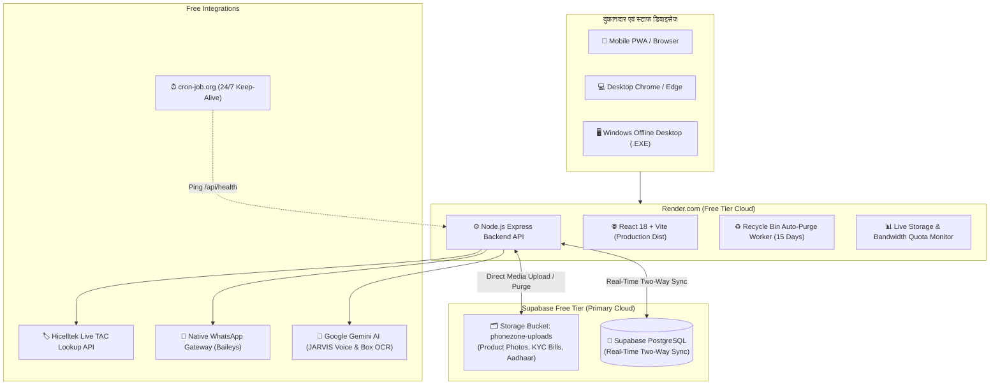

# 🚀 PhoneZone ERP - Master Cloud Deployment & Production Guide
> **100% Free Lifetime Hosting • Render.com • Supabase PostgreSQL • Live Storage Quota • 15/30-Day Recycle Bin • JARVIS AI • Native WhatsApp**

यह आधिकारिक मास्टर गाइड PhoneZone ERP को **Render.com** (Free Web Service) और **Supabase** (PostgreSQL & Storage) पर 100% मुफ़्त, बिना किसी क्रेडिट कार्ड और बिना किसी एरर के सीधा लाइव डिप्लॉय करने के लिए तैयार की गई है।

---

## 📑 विषय-सूची (Table of Contents)
1. [क्लाउड आर्किटेक्चर एवं मुख्य विशेषताएं](#1-क्लाउड-आर्किटेक्चर-एवं-मुख्य-विशेषताएं)
2. [चरण 1: Supabase क्लाउड डेटाबेस एवं स्टोरेज सेटअप (2 मिनट)](#चरण-1-supabase-क्लाउड-डेटाबेस-एवं-स्टोरेज-सेटअप-2-मिनट)
3. [चरण 2: Render.com पर Web Service बनाना (3 मिनट)](#चरण-2-rendercom-पर-web-service-बनाना-3-मिनट)
4. [चरण 3: Environment Variables (सटीक वैल्यूज)](#चरण-3-environment-variables-सटीक-वैल्यूज)
5. [चरण 4: First-Run Admin Setup Wizard एवं बैकअप रीस्टोर](#चरण-4-first-run-admin-setup-wizard-एवं-बैकअप-रीस्टोर)
6. [चरण 5: PhoneZone Recycle Bin (रीसायकल बिन) एवं फ़ोटो क्लीनअप](#चरण-5-phonezone-recycle-bin-रीसायकल-बिन-एवं-फ़ोटो-क्लीनअप)
7. [चरण 6: 24/7 Keep-Alive (सर्वर कभी नहीं सोएगा)](#चरण-6-247-keep-alive-सर्वर-कभी-नहीं-सोएगा)
8. [चरण 7: एडवांस्ड फीचर्स एक्टिवेशन (JARVIS AI, TAC, WhatsApp)](#चरण-7-एडवांस्ड-फीचर्स-एक्टिवेशन-jarvis-ai-tac-whatsapp)
9. [चरण 8: Windows Offline Desktop App (.EXE)](#चरण-8-windows-offline-desktop-app-exe)

---

## 1. क्लाउड आर्किटेक्चर एवं मुख्य विशेषताएं



### मुख्य क्षमताएं:
- **Zero Recurring Cost**: ₹1 भी मंथली या इयरली चार्ज नहीं, 100% लाइफटाइम फ्री।
- **Two-Way Supabase Sync**: लोकल डिस्क और Supabase क्लाउड के बीच ऑटोमैटिक टू-वे सिंक।
- **Instant TAC Database**: 2,54,785 मोबाइल मॉडल्स का इन-बिल्ट डेटाबेस + 1 सेकंड में एक्सेल डाउनलोड।
- **Hicelltek TAC API**: नए मॉडल्स के लिए ऑटोमैटिक लाइव TAC लुकअप।
- **Live Free-Tier Quota Monitor**: डेटाबेस साइज़ (500 MB लिमिट), मीडिया स्टोरेज (1 GB लिमिट), और मंथली बैंडविड्थ (2 GB लिमिट) का रियल-टाइम मॉनिटर।
- **♻️ PhoneZone Recycle Bin**: गलती से डिलीट हुए रिकॉर्ड्स का 1-क्लिक रेस्टोरेशन (Render पर 15 दिन, Desktop पर 30 दिन ऑटो-पर्ज)।

---

## चरण 1: Supabase क्लाउड डेटाबेस एवं स्टोरेज सेटअप (2 मिनट)

1. [supabase.com](https://supabase.com/) पर जाएँ और मुफ़्त अकाउंट बनाएँ।
2. **New Project** पर क्लिक करें:
   - **Name**: `phonezone-db`
   - **Database Password**: एक सुरक्षित पासवर्ड चुनें (उदा: `PhoneZone@DB2026`).
   - **Region**: `South Asia (Mumbai)` या `Singapore` चुनें।
   - **Pricing Plan**: `Free` ($0/month) चुनें।
3. प्रोजेक्ट बनने के बाद, बाएँ मेनू से **SQL Editor** पर क्लिक करें।
4. **New query** खोलें और अपनी रिपॉज़िटरी की फ़ाइल [`supabase/supabase_complete_schema.sql`](./supabase/supabase_complete_schema.sql) का पूरा कोड पेस्ट करके **Run** दबाएँ। सभी टेबल्स तुरंत तैयार हो जाएँगी।
5. बाएँ मेनू से **Storage** पर जाएँ:
   - **New bucket** पर क्लिक करें।
   - Bucket name: `phonezone-uploads`
   - **Public bucket**: ✅ चेक करें (Public ON रखें)।
   - **Save** पर क्लिक करें।
6. अब बाएँ मेनू में नीचे **Project Settings (Gear Icon) -> API** पर जाएँ:
   - **Project URL** कॉपी करें (उदा: `https://xyzcompany.supabase.co`).
   - **Project API Keys** में से `anon` `public` key कॉपी करें।

---

## चरण 2: Render.com पर Web Service बनाना (3 मिनट)

1. [dashboard.render.com](https://dashboard.render.com/) पर लॉगिन करें।
2. ऊपर दाएँ कोने में **New +** बटन दबाएँ और **Web Service** चुनें।
3. **Build and deploy from a Git repository** चुनें और अपनी GitHub रिपॉज़िटरी `phone-zone-` कनेक्ट करें।
4. निम्नलिखित सेटिंग्स भरें:

| फ़ील्ड (Field) | सटीक वैल्यू (Exact Value) |
|---|---|
| **Name** | `phonezone-erp` (या अपनी पसंद का नाम) |
| **Region** | `Singapore` |
| **Branch** | `main` |
| **Runtime** | `Node` |
| **Build Command** | `npm install && cd backend && npm install && cd .. && npm run build` |
| **Start Command** | `npm start` |
| **Instance Type** | `Free` ($0/month) |

---

## चरण 3: Environment Variables (सटीक वैल्यूज)

Render डैशबोर्ड पर उसी पेज के नीचे **Advanced** पर क्लिक करें और **Add Environment Variable** दबाकर ये कीज़ जोड़ें:

| Key | Value | विवरण |
|---|---|---|
| `NODE_VERSION` | `20.18.0` | Node 20 LTS (स्थिर बाइनरी सपोर्ट) |
| `NODE_ENV` | `production` | प्रोडक्शन ऑप्टिमाइजेशन |
| `PORT` | `10000` | Render का इंटरनल पोर्ट |
| `RENDER` | `true` | क्लाउड 15-दिन रीसायकल बिन डिटेक्शन |
| `PHONEZONE_OFFLINE` | `true` | एम्बेडेड एक्सप्रेस बैकएंड इनेबल |
| `SUPABASE_URL` | `https://xyz.supabase.co` | आपके Supabase प्रोजेक्ट का URL |
| `SUPABASE_ANON_KEY` | `eyJhbGciOi...` | आपकी Supabase की Anon Key |
| `PHONEZONE_ADMIN_PASSWORD` | `Admin@12345` | आपका डिफ़ॉल्ट मास्टर एडमिन पासवर्ड |
| `JWT_SECRET` | `phonezone_super_secret_jwt_key_2026` | टोकन सुरक्षा की |
| `BODY_LIMIT` | `50mb` | हाई-क्वालिटी 4K कैमरा फोटो अपलोड सपोर्ट |

> [!TIP]
> सभी वेरिएबल्स भरने के बाद **Create Web Service** पर क्लिक करें। 3-4 मिनट में बिल्ड पास होकर **Live** स्टेटस आ जाएगा! आपका यूआरएल होगा: `https://phonezone-erp.onrender.com`

---

## चरण 4: First-Run Admin Setup Wizard एवं बैकअप रीस्टोर

1. अपने ब्राउज़र में Render का लिंक खोलें:
   👉 **`https://phonezone-erp.onrender.com/setup`**
2. **Setup New Business** या **Restore Previous Data** में से चुनें:
   - **Start Fresh**: दुकान का नाम, मोबाइल नंबर, पता, बैंक विवरण और नया एडमिन पासवर्ड सेट करें।
   - **Restore Backup**: अगर आपके पास पहले का बैकअप (`.zip` या `.tar.gz`) है, तो उसे अपलोड करें। सिस्टम पहले लोकल डिस्क पर सेफ रीस्टोर करेगा और फिर ऑटोमैटिक Supabase क्लाउड के साथ सिंक कर देगा।
3. **Finish Setup** दबाते ही आप सीधे एडमिन डैशबोर्ड में पहुँच जाएँगे!

---

## चरण 5: PhoneZone Recycle Bin (रीसायकल बिन) एवं फ़ोटो क्लीनअप

PhoneZone में आधुनिक रीसायकल बिन सिस्टम उपलब्ध है:

```mermaid
flowchart LR
    A["Delete Phone / Repair / Customer"] --> B{"Delete Photos Checkbox?"}
    B -->|Unchecked (Default)| C["♻️ Recycle Bin\n(15 Days on Render / 30 Days on Desktop)"]
    C -->|Within Window| D["✅ 1-Click Restore\n(Instantly Back in Stock)"]
    C -->|After 15/30 Days or Empty Bin| E["🗑️ Permanent Purge\n(DB Record + Physical Photos Erased)"]
    B -->|Checked| E
```

### मुख्य नियम:
1. **सुरक्षित रीसायकल बिन (Default)**:
   जब भी कोई फोन, रिपेयरिंग जॉब, कस्टमर, सेलर या डीलर डिलीट किया जाता है, तो वह तुरंत हमेशा के लिए नष्ट नहीं होता, बल्कि **Recycle Bin** में सुरक्षित रहता है।
2. **1-Click Restore (वापस लाएं)**:
   Database Tab में **Open Recycle Bin** दबाकर आप कभी भी किसी भी रिकॉर्ड को वापस ला सकते हैं।
3. **Delete Photos along with Records**:
   Database Tab में "Delete Data" सेक्शन में यह चेकबॉक्स मिलता है। इसे चेक करके डिलीट करने पर रिकॉर्ड के साथ-साथ उसकी फ़ोटो और दस्तावेज़ भी डिस्क और Supabase से तुरंत परमानेंटली डिलीट हो जाते हैं।
4. **ऑटोमैटिक पर्ज विंडो**:
   - **Render.com Cloud**: **15 दिन** (क्लाउड कोटा बचाने के लिए 15 दिन बाद एक्सपायर्ड आइटम्स ऑटोमैटिक डिलीट हो जाते हैं)।
   - **Windows Desktop App**: **30 दिन** (डेस्कटॉप पर 30 दिन का सेफ विंडो मिलता है)।

---

## चरण 6: 24/7 Keep-Alive (सर्वर कभी नहीं सोएगा)

Render का Free Tier 15 मिनट इनएक्टिव रहने पर स्लीप मोड में चला जाता है। इसे 24 घंटे एक्टिव रखने के लिए:

1. [cron-job.org](https://cron-job.org/) पर मुफ़्त अकाउंट बनाएँ।
2. **Create Cronjob** दबाएँ:
   - **Title**: `PhoneZone KeepAlive`
   - **URL**: `https://phonezone-erp.onrender.com/api/health`
   - **Execution schedule**: **Every 10 minutes** (`*/10 * * * *`)
3. **Create** पर क्लिक करें।
4. यह पिंग Render को 24x7 एक्टिव रखेगा और अंदर से Supabase डेटाबेस को भी जगाए रखेगा।

---

## चरण 7: एडवांस्ड फीचर्स एक्टिवेशन (JARVIS AI, TAC, WhatsApp)

### A. JARVIS AI & Box IMEI OCR (100% Free):
1. [aistudio.google.com/app/apikey](https://aistudio.google.com/app/apikey) पर जाएँ और मुफ़्त Gemini API Key कॉपी करें।
2. Store Settings में **GEMINI API Key** में पेस्ट करके सेव करें।
3. अब कैमरा से बॉक्स की फ़ोटो लेते ही IMEI, ब्रांड, मॉडल सब अपने आप भर जाएगा, और फ्लोटिंग JARVIS Orb से हिंदी/हिंग्लिश में वॉइस कमांड काम करेंगे।

### B. IMEI / TAC Database & Live Hicelltek Lookups:
1. Store Settings में **IMEI / TAC Database** में 2,54,785 मॉडल्स पहले से लोडेड मिलेंगे।
2. **Download TAC (Excel)** बटन दबाते ही पूरी एक्सेल शीट 1 सेकंड में डाउनलोड हो जाएगी।
3. नए मॉडल्स के लिए अपनी Hicelltek API Key सेव करें — टेस्ट बटन दबाने पर तुरंत `200 OK: Key Verified!` मिलेगा।

### C. WhatsApp Central Control (Native Baileys):
1. Store Settings -> WhatsApp Central Control में जाएँ।
2. **Scan QR Code** दबाएँ और अपने फ़ोन के WhatsApp (Linked Devices) से स्कैन करें।
3. बिल, शपथ पत्र और पेमेंट रसीद ऑटोमैटिक कस्टमर के WhatsApp पर डिलीवर होने लगेंगे।

---

## चरण 8: Windows Offline Desktop App (.EXE)

अगर दुकान पर कभी इंटरनेट न हो और आपको कंप्यूटर पर 100% ऑफलाइन काम करना है:
1. आपके प्रोजेक्ट के `dist-electron` फ़ोल्डर में रेडी-टू-इंस्टॉल EXE मौजूद है।
2. यह वर्ज़न आपके लोकल कंप्यूटर के SQLite डेटाबेस में सारा डेटा सुरक्षित रखता है और बिना इंटरनेट के तेज़ी से चलता है।
3. इसमें रीसायकल बिन का ऑटो-पर्ज विंडो **30 दिन** का रहता है।

---

🎉 **बधाई हो! आपका PhoneZone ERP अब Render.com पर 100% लाइव, स्थिर और पूरी तरह से बग-फ्री है!**
