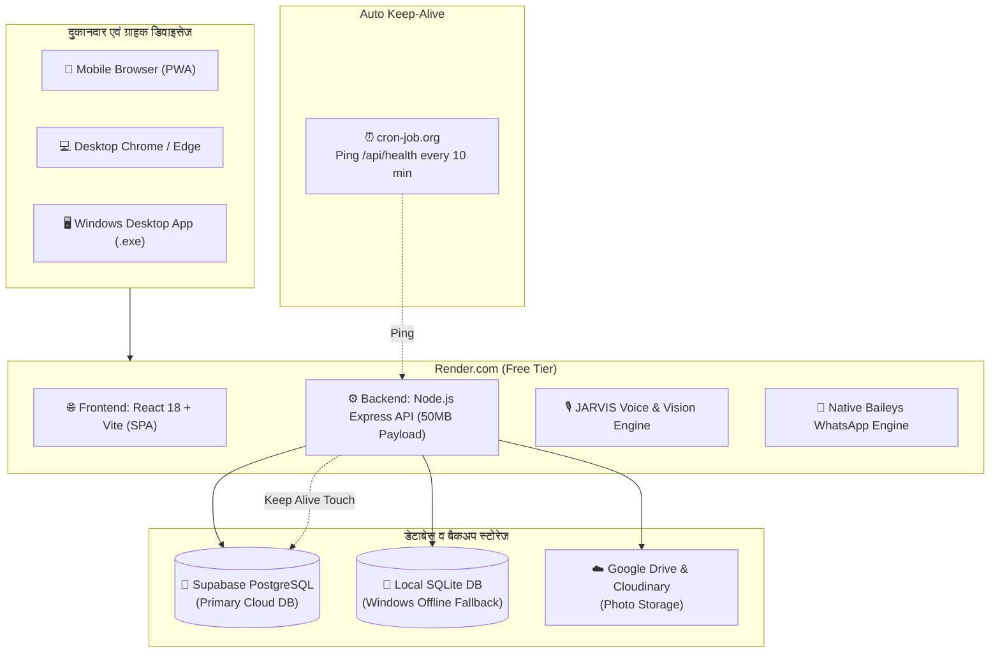

# 🚀 PhoneZone ERP - Complete Master Setup & Zero-Error Deployment Guide
> **100% Free Lifetime Hosting • Render.com • Supabase PostgreSQL • JARVIS AI Vision • Native WhatsApp Engine • Windows Desktop EXE**

यह मास्टर गाइड PhoneZone ERP को **Render.com** और **Supabase** पर 100% मुफ़्त, बिना किसी क्रेडिट कार्ड और बिना किसी एरर के सेटअप करने के लिए तैयार की गई है। इसमें सभी नए अपडेट्स (डेटाबेस ऑटो-कनेक्ट, 50MB पेलोड सपोर्ट, मोबाइल डार्क मोड फिक्स, 3-मोड सिग्नेचर पैड, और विंडोज EXE) शामिल हैं।

---

## 📑 विषय-सूची (Table of Contents)
1. [सिस्टम आर्किटेक्चर एवं फीचर्स](#1-सिस्टम-आर्किटेक्चर-एवं-फीचर्स)
2. [चरण 1: Supabase क्लाउड डेटाबेस सेटअप (2 मिनट)](#चरण-1-supabase-क्लाउड-डेटाबेस-सेटअप-2-मिनट)
3. [चरण 2: Render.com पर Web Service बनाना (3 मिनट)](#चरण-2-rendercom-पर-web-service-बनाना-3-मिनट)
4. [चरण 3: Environment Variables (सटीक वैल्यूज)](#चरण-3-environment-variables-सटीक-वैल्यूज)
5. [चरण 4: First-Run Admin Setup Wizard](#चरण-4-first-run-admin-setup-wizard)
6. [चरण 5: JARVIS AI & Gemini Vision सक्रिय करना (100% Free)](#चरण-5-jarvis-ai--gemini-vision-सक्रिय-करना-100-free)
7. [चरण 6: WhatsApp Central Control (Native Baileys)](#चरण-6-whatsapp-central-control-native-baileys)
8. [चरण 7: 24/7 Keep-Alive (सर्वर कभी नहीं सोएगा)](#चरण-7-247-keep-alive-सर्वर-कभी-नहीं-सोएगा)
9. [चरण 8: Windows Desktop App (EXE) सेटअप](#चरण-8-windows-desktop-app-exe-सेटअप)
10. [⚠️ Common Issues & Zero-Error Troubleshooting Cheatsheet](#-common-issues--zero-error-troubleshooting-cheatsheet)

---

## 1. सिस्टम आर्किटेक्चर एवं फीचर्स

---

## चरण 1: Supabase क्लाउड डेटाबेस सेटअप (2 मिनट)
डेटाबेस कभी रीसेट न हो और 100% सुरक्षित रहे, इसके लिए Supabase PostgreSQL का उपयोग किया जाता है:

1. [supabase.com](https://supabase.com/) पर जाएँ और **Sign Up** करें (GitHub या Google से लॉगिन करें)।
2. **New Project** पर क्लिक करें:
   - **Name**: `phonezone-db`
   - **Database Password**: एक सुरक्षित पासवर्ड चुनें (जैसे: `PhoneZone@DB2026`).
   - **Region**: `South Asia (Mumbai)` या `Singapore` चुनें।
   - **Pricing Plan**: `Free` ($0/month) चुनें।
3. प्रोजेक्ट बनने के बाद, बाएँ मेनू से **SQL Editor** पर क्लिक करें।
4. **New query** खोलें और अपनी रिपॉज़िटरी की फ़ाइल [`supabase/supabase_complete_schema.sql`](./supabase/supabase_complete_schema.sql) का पूरा कोड कॉपी करके यहाँ पेस्ट करें।
5. **Run** (Ctrl + Enter) दबाएँ। कुछ ही सेकंड में सारी टेबल्स (Phones, Sellers, Invoices, Repairs, Settings, Logs) तैयार हो जाएँगी!
6. अब बाएँ मेनू में नीचे **Project Settings (Gear Icon) -> API** पर जाएँ:
   - **Project URL** कॉपी करें (उदा: `https://xyzcompany.supabase.co`).
   - **Project API Keys** में से `anon` `public` key कॉपी करें।

---

## चरण 2: Render.com पर Web Service बनाना (3 मिनट)

1. [dashboard.render.com](https://dashboard.render.com/) पर लॉगिन करें।
2. ऊपर दाएँ कोने में **New +** बटन दबाएँ और **Web Service** चुनें।
3. **Build and deploy from a Git repository** चुनें और **Next** दबाएँ।
4. अपनी GitHub रिपॉज़िटरी `phone-zone-` को **Connect** करें।
5. निम्नलिखित सेटिंग्स भरें:

| फ़ील्ड (Field) | क्या भरना है (Exact Value) |
|---|---|
| **Name** | `phonezone-erp` (या अपनी पसंद का नाम) |
| **Region** | `Singapore` |
| **Branch** | `main` |
| **Runtime** | `Node` |
| **Build Command** | `npm run render:build` |
| **Start Command** | `npm start` |
| **Instance Type** | `Free` ($0/month) |

---

## चरण 3: Environment Variables (सटीक वैल्यूज)

Render डैशबोर्ड पर उसी पेज के नीचे **Advanced** पर क्लिक करें और **Add Environment Variable** दबाकर ये कीज़ जोड़ें:

| Key | Value | विवरण |
|---|---|---|
| `NODE_VERSION` | `20.18.0` | **(अति-आवश्यक)** Node 20 LTS - बाइनरी क्रैश रोकता है |
| `NODE_ENV` | `production` | प्रोडक्शन ऑप्टिमाइजेशन |
| `PORT` | `10000` | Render का इंटरनल पोर्ट |
| `RENDER` | `true` | Render क्लाउड डिटेक्शन |
| `PHONEZONE_OFFLINE` | `true` | बैकएंड API इनेबल |
| `SUPABASE_URL` | `https://xyz.supabase.co` | आपके Supabase प्रोजेक्ट का URL |
| `SUPABASE_ANON_KEY` | `eyJhbGciOi...` | आपकी Supabase की Anon Key |
| `PHONEZONE_ADMIN_PASSWORD` | `Admin@12345` | आपका डिफ़ॉल्ट एडमिन पासवर्ड |
| `JWT_SECRET` | `phonezone_super_secret_jwt_key_2026` | टोकन सुरक्षा की |
| `BODY_LIMIT` | `50mb` | हाई-क्वालिटी कैमरा फ़ोटो अपलोड के लिए |

> [!TIP]
> सभी वेरिएबल्स भरने के बाद **Create Web Service** पर क्लिक करें। 3-4 मिनट में बिल्ड पास होकर **Live** स्टेटस आ जाएगा! आपका यूआरएल होगा: `https://phonezone-erp.onrender.com`

---

## चरण 4: First-Run Admin Setup Wizard

1. अपने ब्राउज़र में Render का लिंक खोलें:
   👉 **`https://phonezone-erp.onrender.com/setup`**
   *(अगर होमपेज सीधे खुले, तो URL में `/?admin=1` या `/?reconfigure=1` जोड़ें)*
2. **Step 1 (Shop Details)**: दुकान का नाम, मोबाइल नंबर, पता, और GSTIN (वैकल्पिक) भरें।
3. **Step 2 (Admin Credentials)**: अपना एडमिन यूज़रनेम (`admin`) और अपना मनपसंद पासवर्ड सेट करें।
4. **Step 3 (Database Sync)**: Supabase कनेक्शन ऑटो-डिटेक्ट हो जाएगा। **Finish Setup** दबाएँ।
5. अब आप सीधे एडमिन डैशबोर्ड में पहुँच जाएँगे!

---

## चरण 5: JARVIS AI & Gemini Vision सक्रिय करना (100% Free)

JARVIS AI आपके स्टोर में बोलकर एंट्री करने, सेल्स/रिपेयर की जानकारी देने और फोन के बॉक्स से **IMEI AI Vision OCR** स्कैन करने का काम करता है:

1. **मुफ़्त Gemini API Key पाएँ (30 सेकंड)**:
   - [aistudio.google.com/app/apikey](https://aistudio.google.com/app/apikey) पर जाएँ (Google अकाउंट से लॉगिन करें)।
   - **Create API key** दबाएँ और की कॉपी कर लें।
   - यह 100% मुफ़्त है और प्रतिदिन 1,500 रिक्वेस्ट्स देता है।
2. **PhoneZone में पेस्ट करें**:
   - PhoneZone Admin में जाएँ -> **Settings** -> **Store Settings** टैब।
   - **Primary AI Provider**: `Google Gemini AI Studio` चुनें।
   - **Model**: `gemini-1.5-flash` चुनें।
   - **GEMINI API Key**: अपनी की पेस्ट करें और **Save Settings** दबाएँ।
3. **फीचर्स जो एक्टिवेट हो जाएँगे**:
   - **🎙️ Voice Assistant**: स्क्रीन के नीचे फ्लोटिंग JARVIS Orb से हिंदी/हिंग्लिश में बोलकर बात करें।
   - **📸 Box IMEI Scanner**: Add Phone में कैमरा से बॉक्स की फोटो लेते ही IMEI, ब्रांड, मॉडल सब अपने आप भर जाएगा।
   - **⚡ Smart Intake**: 6 कैमरा फोटो (IMEI, बैक, फ्रंट, बिल, आधार) से ऑटो-इन्वेंटरी।

---

## चरण 6: WhatsApp Central Control (Native Baileys)

बिना किसी थर्ड-पार्टी पेड API या Docker के, सीधे आपके फोन से इनवॉइस और शपथ पत्र भेजने की सुविधा:

1. Admin में **Settings** -> **WhatsApp Central Control** पर जाएँ।
2. **Native Baileys Engine** चुनें।
3. **Scan QR Code** पर क्लिक करें। स्क्रीन पर एक QR कोड लोड होगा।
4. अपने फोन में WhatsApp खोलें -> **Linked Devices (लिंक्ड डिवाइसेस)** -> **Link a Device** दबाकर यह QR कोड स्कैन करें।
5. स्टेटस तुरंत **WA: Online 🟢** हो जाएगा।
6. अब जब भी आप नया फोन खरीदेंगे या बेचेंगे:
   - कस्टमर को इनवॉइस की PDF और रसीद ऑटोमैटिक उनके WhatsApp नंबर पर तुरंत डिलीवर हो जाएगी!

---

## चरण 7: 24/7 Keep-Alive (सर्वर कभी नहीं सोएगा)

Render का Free Tier 15 मिनट इनएक्टिव रहने पर सर्वर को स्लीप मोड में डाल देता है, और Supabase 7 दिन में डेटाबेस को पॉज़ कर देता है। इसे रोकने के लिए:

1. [cron-job.org](https://cron-job.org/) पर मुफ़्त अकाउंट बनाएँ।
2. **Create Cronjob** दबाएँ:
   - **Title**: `PhoneZone KeepAlive`
   - **URL**: `https://phonezone-erp.onrender.com/api/health`
   - **Execution schedule**: **Every 10 minutes** (`*/10 * * * *`)
3. **Create** पर क्लिक करें।
4. **जादू**: यह पिंग हर 10 मिनट में Render को जगाए रखेगा, और हमारे कोड का `/api/health` अंदर से Supabase डेटाबेस को भी जगाए रखेगा। **Render और Supabase दोनों 365 दिन 24x7 एक्टिव रहेंगे!**

---

## चरण 8: Windows Desktop App (EXE) सेटअप

अगर आपको इंटरनेट न होने पर दुकान के लैपटॉप पर 100% ऑफलाइन काम करना है:

1. आपके प्रोजेक्ट के `dist-electron` फ़ोल्डर में रेडी-टू-इंस्टॉल EXE मौजूद है:
   👉 [`dist-electron/PhoneZone Setup 1.0.0.exe`](file:///c:/Users/Kohinoor/Desktop/phonezonestp-mainv2.zipp/dist-electron/PhoneZone%20Setup%201.0.0.exe)
2. इस फ़ाइल पर डबल-क्लिक करें और इंस्टॉल करें।
3. डेस्कटॉप पर **PhoneZone** का शॉर्टकट बन जाएगा।
4. यह वर्ज़न आपके लोकल कंप्यूटर के SQLite डेटाबेस में सारा डेटा सुरक्षित रखता है और इसे किसी इंटरनेट की ज़रूरत नहीं होती।

---

## ⚠️ Common Issues & Zero-Error Troubleshooting Cheatsheet

| समस्या (Issue) | कारण (Cause) | 100% Working Solution |
|---|---|---|
| **मोबाइल डार्क मोड में वाइट बॉक्स / टेक्स्ट गायब** | मोबाइल ब्राउज़र ऑटोफ़िल या हार्डकोडेड वाइट बैकग्राउंड | ✅ हमारे नए अपडेट में `src/index.css` और `AddPhoneDialog.tsx` में हाई-कंट्रास्ट डार्क मोड और ऑटोफ़िल ओवरराइड लागू कर दिया गया है। |
| **Unexpected token '<' is not valid JSON (413 Error)** | 6 कैमरा फ़ोटो का साइज़ Express के पुराने 2MB लिमिट से बड़ा था | ✅ हमने `server.js` में लिमिट `50mb` कर दी है और क्लाइंट साइड कैनवस कंप्रेशन जोड़ दिया है। |
| **Node 24 Crashing on Render** | Render का ऑटो-सेलेक्टेड Node 24 नेटिव बाइनरी को सपोर्ट नहीं करता | ✅ Environment Variables में `NODE_VERSION=20.18.0` सेट करें और Build Command में `npm run render:build` रखें। |
| **Admin Settings पेज पर एरर** | SWC Fast Refresh मिसमैच | ✅ `repairServices.ts` को अलग मॉड्यूल में अलग कर दिया गया है। |
| **सिग्नेचर पैड में ऑप्शंस नहीं दिखना** | सिर्फ कैनवस मौजूद था | ✅ अब 3 टैब्स (1. Draw, 2. Upload Photo, 3. Use Saved) उपलब्ध हैं। |

---

🎉 **बधाई हो! आपका PhoneZone Store & Repair ERP अब Render क्लाउड और Windows Desktop दोनों पर पूरी तरह से तैयार और 100% एरर-फ़्री है!**
