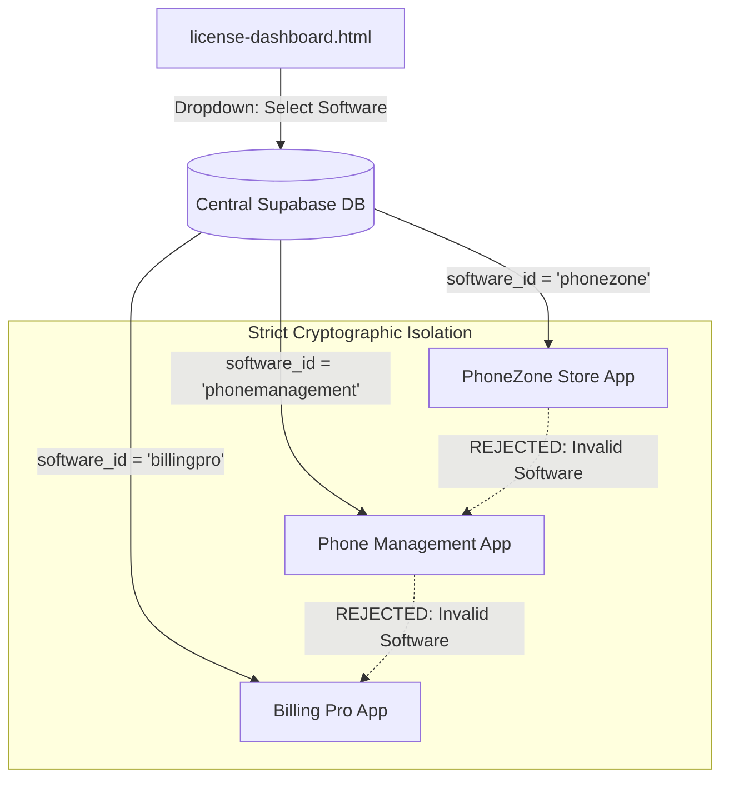

# 🔌 Universal Multi-Software Licensing Integration Guide (`INTEGRATION_GUIDE.md`)

> **For Future Projects**: Use this guide whenever you create a new software (e.g. `phonemanagement`, `billingpro`, `inventory_master`, etc.).  
> Follow these exact steps to add complete, rock-solid central licensing in **under 3 minutes**!

---

## 🏛️ 1. Architecture & Software Isolation Guarantee



### Why Keys NEVER Collide Across Softwares:
In the central database, every license row has a `software_id` column:
```sql
SELECT * FROM public.licenses
WHERE software_id = p_software_id AND license_key = UPPER(TRIM(p_license_key));
```
- A key generated for `phonemanagement` will **ALWAYS FAIL** on `phonezone`.
- A key generated for `phonezone` will **ALWAYS FAIL** on `phonemanagement`.
- One single Supabase project manages up to **50+ independent softwares** with zero database pollution or conflict!

---

## 📦 2. Folder Structure Inside `license-management/`

```text
license-management/
├── license-dashboard.html        # Master web dashboard (single-file, works on Phone/PC/Tablet)
├── supabase_licensing_schema.sql # Complete Supabase DB schema + RPCs
├── INTEGRATION_GUIDE.md          # This complete step-by-step guide
│
├── backend-module/               # Drop these into your new backend:
│   ├── hardwareId.js             # Generates machine HWID (Windows, Kali, Termux, APK, Render)
│   ├── licenseService.js         # Core validation, God Mode hashes, offline grace period
│   ├── licenseRoutes.js          # Express router for /api/license/* endpoints
│   └── 028_license_system.sql    # SQLite table schema for local state persistence
│
├── frontend-module/              # Drop into your new frontend:
│   └── LicenseActivationModal.tsx # React/Tailwind activation dialog with HWID copy button
│
└── launchers/                    # Drop into your project root for 1-click execution:
    ├── run-windows.bat           # 1-click Windows zero-config launcher (auto npm install & start)
    ├── run-termux.sh             # 1-click Android Termux launcher (auto pkg install & start)
    └── run-linux.sh              # 1-click Linux / Kali launcher
```

---

## ⚡ 3. Three-Step Integration into ANY New Project

### Step 1: Copy Backend Files
1. Copy `hardwareId.js`, `licenseService.js`, and `licenseRoutes.js` into your new project's backend (e.g. `backend/src/services/`).
2. Open `licenseService.js` and set your software identifier:
   ```javascript
   // Change "phonezone" to your new software ID:
   const SOFTWARE_ID = process.env.SOFTWARE_ID || "my_new_software_id";
   ```
3. In your Express `server.js` or `app.js`, mount the router:
   ```javascript
   import { licenseRouter } from "./routes/licenseRoutes.js";
   app.use("/api/license", licenseRouter);
   ```
4. Execute `028_license_system.sql` in your SQLite database on startup (creates `license_state` table).

---

### Step 2: Register Software in `license-dashboard.html`
1. Open `license-dashboard.html` in your browser.
2. At the top header, click the **`+` (Plus icon)** next to the Software dropdown.
3. Enter:
   - **Software ID**: `my_new_software_id` (matches the ID in Step 1)
   - **Software Display Name**: `My New Software Name`
   - **Description**: `POS and Billing system`
4. Click **Register Software**!
5. Now select your new software from the dropdown — you can now issue and manage licenses specifically for this software!

---

### Step 3: Add Frontend Activation Modal
1. Copy `LicenseActivationModal.tsx` into your frontend components.
2. In your Header or Settings page, add the License button:
   ```tsx
   import { LicenseActivationModal } from "./components/LicenseActivationModal";
   
   // In component:
   const [showLicenseModal, setShowLicenseModal] = useState(false);
   
   <button onClick={() => setShowLicenseModal(true)}>
     License Status
   </button>
   
   <LicenseActivationModal 
     isOpen={showLicenseModal} 
     onClose={() => setShowLicenseModal(false)} 
   />
   ```

---

## 🚀 4. One-Click Launchers (Extract & Run Anywhere)

Whenever you deliver a project as a `.zip`:

### 🪟 Windows (Double-Click `.bat`):
- User extracts the ZIP and double clicks `run-windows.bat`.
- It automatically:
  - Checks if Node.js is installed (prompts download if missing).
  - Checks if `node_modules` exists; if not, automatically runs `npm install`.
  - Checks if frontend build exists; if not, builds it.
  - Starts backend on port 47713.
  - Automatically pops up the default browser at `http://localhost:47713`!

### 📱 Android Termux (`run-termux.sh`):
- User opens Termux on their Android phone.
- Runs: `bash run-termux.sh`
- It automatically:
  - Runs `pkg install -y nodejs` if Node is missing.
  - Runs `npm install`.
  - Starts the server and displays the local phone URL: `http://localhost:47713` and Wi-Fi IP so other family members/staff can connect!
  - Auto-opens Chrome on Android.

### 🐧 Kali Linux / Ubuntu (`run-linux.sh`):
- User opens terminal and runs: `bash run-linux.sh`
- Auto-checks apt packages, runs npm install, and launches browser via `xdg-open`.

### ☁️ Cloud (Render.com):
- Push repo to GitHub and connect to Render.com Web Service.
- Build command: `npm install && npm run build`
- Start command: `node backend/src/server.js`
- 14-day offline grace period ensures that if Render sleeps or restarts, existing merchants are never blocked!

---

## 👑 5. Master Secret Keys (God Mode)

These master keys work across **ALL** softwares using this module:

| Master Key | Hashes in Code | Function |
| :--- | :--- | :--- |
| `9211921192119211` | `015acc62fdf15a1455ae47a1504875b4961de972d2545be59f08ee8d51c22298` | Instant Lifetime Free God Mode |
| `Humsafar@1998Humsafar@1998Humsafar@1998Humsafar@1998` | `6362ce8bcc58f5d427865ba54fdc59d60c87e5fc7a05ea22949c151bbaee9901` | Instant Lifetime Free God Mode |

- Works completely **OFFLINE** without internet or Supabase.
- Stores encrypted SHA-256 hash in SQLite.
- Enables God Mode badge and unblocks all features forever.
