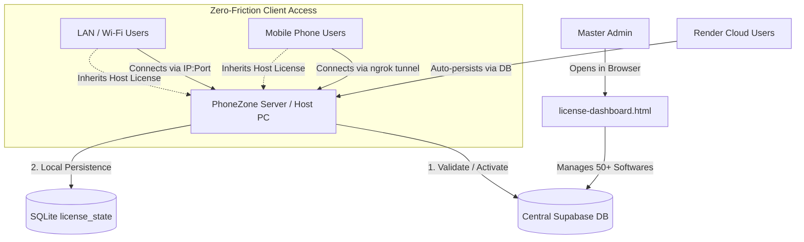

# 🔐 Multi-Software Central Licensing System — Complete Guide (`licenseguide.md`)

> **Document Type**: Living Implementation & Operations Guide  
> **Target Softwares**: PhoneZone, Phone Management, and up to 50+ future softwares  
> **Host Compatibility**: Windows EXE, Linux / Kali (.sh), Android Termux / APK, Cloud Web / Render  

---

## 📌 1. System Architecture Overview



### Key Highlights:
1. **1 Supabase Free Project = 50+ Softwares**: Supabase ke free plan me sirf 2 projects limit hoti hai. Is system me ek hi Supabase project ke andar `software_registry` table se multiple software configure ho jate hain (`phonezone`, `phonemanagement`, etc.).
2. **Server-Bound Activation**: License hamesha host server machine par activate hota hai. LAN par jude users, ngrok se access kar rahe phone browsers, ya web users ko dobara license key enter nahi karni padti.
3. **Hardware Lock (HWID) & Device Concurrency**:
   - `HWID Lock = ON`: License key sirf usi specific machine par kaam karegi.
   - `Max Devices = 1`: Agar kisi doosre PC par key use karni hai, toh pehle purane PC se deactivate/logout karna hoga.
4. **Platform Entitlements**: Key generate karte waqt aap choose kar sakte hain ki ye key sirf `EXE` par chalegi, `APK` par, ya sabhi par (`all`).
5. **Offline Grace Period (14 Days) & Render Reboot Resilience**:
   - Cloud ya local network disconnect hone par software merchant ka kaam nahi rokta (14 din ka offline grace period).
   - Render server ke sleep/restart hone par SQLite me state preserved rehti hai.
6. **Master Secret Keys (God Mode)**:
   - Built-in lifetime free secret keys jo code me encrypted (SHA-256 hash) rehti hain. Internet/Supabase ke bina bhi instant activate ho jati hain.

---

## 🔑 2. Master Secret Keys (God Mode Lifetime Free)

Agar aapko kisi shop ya testing ke liye bina Supabase ke lifetime unlock karna ho:

| Master Code | Storage Type in Code | Scope |
| :--- | :--- | :--- |
| `9211921192119211` | SHA-256 Hash (`015acc62fdf15a14...`) | Lifetime Unlimited God Mode |
| `Humsafar@1998Humsafar@1998Humsafar@1998Humsafar@1998` | SHA-256 Hash (`6362ce8bcc58f5d4...`) | Lifetime Unlimited God Mode |

> [!IMPORTANT]
> Ye master keys source code me plain text me **kabhi nahi likhi gayi hain**. Backend sirf cryptographic hashes compare karta hai.

---

## 🚀 3. Step-by-Step Setup Guide

### Step 1: Supabase Database Setup
1. [supabase.com](https://supabase.com) par login karein aur apna licensing project select karein (ya naya banayein).
2. Left sidebar me **SQL Editor** par click karein -> **New query**.
3. Workspace ki file [`supabase_licensing_schema.sql`](file:///c:/Users/Kohinoor/Desktop/phonezonestp-mainv2.zipp/supabase_licensing_schema.sql) ka pura code copy karein, SQL Editor me paste karein aur **Run** (Ctrl+Enter) dabayein.
4. Ye automatically:
   - `software_registry` table banayega aur `phonezone` + `phonemanagement` register karega.
   - `licenses` table banayega with HWID, max devices, platform constraints.
   - `license_admin_auth` table banayega with default dashboard password hash.
   - RPC functions (`validate_or_activate_license`, `deactivate_license_device`, `admin_verify_password`, `admin_change_password`) configure karega.

---

### Step 2: Supabase Credentials Note Karein
Supabase dashboard me:
1. Left sidebar niche **Project Settings** (Gear icon) -> **API** (ya **API Keys**) me jayein.
2. Wahan aapko 2 keys dikhengi (New Supabase Interface):
   - **Publishable key** (`sb_publishable_D7kiQTcdnrb7NhOJhZ2dQw_6Fqnuhlk`): Ye browser dashboard (`license-dashboard.html`) aur client apps ke liye use hoti hai.
   - **Secret keys** (`sb_secret_YOUR_SUPABASE_SECRET_KEY`): Ye server/backend functions ke liye hoti hai (GitHub par push nahi karte).

---

### Step 3: Supabase Free Sleep Prevention (Keep-Alive Cron Job)
Supabase free tier 7 din inactive rehne par database ko sleep (pause) kar deta hai. Isko 24/7 active rakhne ke liye:

1. [cron-job.org](https://cron-job.org) par free account banayein.
2. **Create Cronjob** par click karein.
3. Form me details bharein:
   - **Title**: `Supabase Licensing Keep-Alive`
   - **URL**: `https://nfktxnjxdmqcvlghlodi.supabase.co/rest/v1/software_registry?select=id&limit=1`
   - **Schedule**: Every 12 Hours (ya Every 1 Day)
   - **Request Method**: `GET`
   - **Headers** (Under Advanced -> Headers):
     - **Header 1**: Key: `apikey` | Value: `sb_publishable_D7kiQTcdnrb7NhOJhZ2dQw_6Fqnuhlk`
     - **Header 2**: Key: `Authorization` | Value: `Bearer sb_publishable_D7kiQTcdnrb7NhOJhZ2dQw_6Fqnuhlk`
4. **Save** karein. Ab aapka Supabase project kabhi sleep nahi hoga!

---

### Step 4: Master License Dashboard Setup (`license-dashboard.html`)
[`license-dashboard.html`](file:///c:/Users/Kohinoor/Desktop/phonezonestp-mainv2.zipp/license-dashboard.html) ek portable, single-file master dashboard hai jisme koi node install kiye bina kisi bhi browser me direct run kiya ja sakta hai.

1. `license-dashboard.html` file ko Chrome / Edge me double-click karke open karein.
2. **Login**:
   - Default Master Password: `admin`
   - *(Dashboard ke top-right me "Change Password" button se aap ise kabhi bhi change kar sakte hain — change karte hi nayi updated file automatically download ho jati hai).*
3. **Manage Softwares**:
   - Header me dropdown se select karein: `PhoneZone (phonezone)` ya `Phone Management (phonemanagement)`.
   - Naya software add karne ke liye **+ Register New Software** par click karein aur `software_id` (jaise `billingpro`) daal dein. Ek project me 50+ softwares chalenge.

---

### Step 5: License Key Generate Karna (Custom Days & Date Support)
Dashboard me **"+ Create License"** modal open karein:
- **Customer Name**: Merchant ka naam (e.g. `Ramesh Mobile Store`)
- **Shop / Business**: Dukan ka naam (e.g. `Shakshi Mobile`)
- **Phone Number**: WhatsApp number (WhatsApp share ke liye)
- **Validity Options**:
  - **Quick Pills**: `7d`, `15d`, `30d`, `90d`, `365d`, `Custom Days`, `Calendar Date`, `Lifetime`
  - **Custom Days**: Koi bhi specific days count daalein (e.g. 45 days, 60 days).
  - **Calendar Date**: Direct calendar picker se expiry date choose karein.
- **Max Concurrent Devices**: `1 PC` (default), `2 PC`, etc.
- **Lock to Machine HWID**: Toggle ON/OFF (1st machine par automatically bind hota hai).
- **Allowed Platforms**: Checkbox: `[x] Windows EXE`, `[x] Android APK`, `[x] Linux`, `[x] Web`.
- **Existing Licenses**: Har row me `+30d` aur `+Custom Days / Lifetime` ka button hai jisse validity kabhi bhi extend ya lifetime me convert ho sakti hai.
- **Generate Key** dabayein. Key format: `PZON-XXXX-XXXX-XXXX`
- **WhatsApp Share**: Key card par WhatsApp icon dabate hi direct customer ke WhatsApp par ready-made message send ho jata hai.

---

### Step 6: PhoneZone App me License Activate Karna
1. PhoneZone app open karein (`http://localhost:47713`).
2. Header me **License** badge par click karein (ya Settings me **License Management** par jayein).
3. Dialog me aapko machine ka **Hardware ID (HWID)** dikhai dega:
   - Example: `HWID-A4454477-3E6D96F6-C9D33355`
4. Customer Name, Shop Name aur License Key enter karein (ya Master Secret Key daalein).
5. **Activate License** button par click karein.
6. ✅ **Activated** status show hoga aur saare features unlock ho jayenge!

---

## 🛠️ 4. Known Issues & Troubleshooting Log

Yeh section living log hai — jo bhi dikkat aayi aur uska jo permanent fix nikala gaya, wo yahan note hai:

### Issue #1: Port Collision during Verification (`EADDRINUSE 47713`)
- **Problem**: Jab background dev server chal raha ho aur `verify-all.mjs` test suite run ki jaye, toh dono port 47713 par connect karne ki koshish karte hain aur server boot fail ho jata hai.
- **Fix**: Tests run karne se pehle background dev server task ko stop karein, ya test suite ko random available port (`PHONEZONE_PORT=0`) assign karein.

### Issue #2: Node Undici HTTP Keep-Alive Socket Reset (`read ECONNRESET`)
- **Problem**: Jab backend initial boot par `tac_full.xlsx` (250,000+ records) import kar raha hota hai (lagbhag 20 seconds), toh Node HTTP client ka pooled keep-alive socket idle timeout (5s) cross hone par reset ho jata tha aur agla request `fetch failed: read ECONNRESET` de deta tha.
- **Fix**: `scripts/verify-all.mjs` ke `makeClient` me automatic retry-on-ECONNRESET implement kiya gaya:
  ```js
  let res;
  try {
    res = await fetch(`${base}${url}`, { method, headers, body: payload, redirect: "manual" });
  } catch (e) {
    if (e?.cause?.code === "ECONNRESET" || e?.code === "ECONNRESET" || /ECONNRESET/.test(String(e))) {
      res = await fetch(`${base}${url}`, { method, headers, body: payload, redirect: "manual" });
    } else {
      throw e;
    }
  }
  ```

### Issue #3: Multi-User / Mobile Access Asking for License
- **Problem**: Host PC par license activate hone ke baad bhi agar mobile phone se access karein toh kya license dobara mangega?
- **Fix**: License verification ko **Server-Side SQLite (`license_state`)** me store kiya gaya hai. Client browser ko sirf read-only `/api/license/status` milta hai. Jab host server par license valid hai, toh koi bhi LAN ya ngrok user bina prompt ke smoothly app use kar sakta hai.

### Issue #4: Render Cloud Reboot / Sleep Memory Loss
- **Problem**: Render free tier 15 minutes inactivity par sleep ho jata hai. Re-wake hone par agar memory reset ho toh unlicensed ho jata tha.
- **Fix**: License state SQLite disk file me persist rehti hai aur sath hi 14-day offline grace period diya gaya hai, taaki network delay ya Render spin-up time me app block na ho.

### Issue #5: Supabase SQL Error 42883 on `GRANT EXECUTE`
- **Problem**: Supabase SQL Editor me `ERROR: 42883: could not find a function named "public.validate_or_activate_license"` error aana.
- **Root Cause**:
  1. PostgreSQL me function grant karte waqt parameter types `(TEXT, TEXT, ...)` zaroori hote hain ya `GRANT EXECUTE ON ALL FUNCTIONS IN SCHEMA public` use karna hota hai.
  2. SQL Editor me paste karte waqt file ka sirf aakhri hissa (last few lines) paste hua tha, puri file (lines 1 to 290) paste nahi hui thi, jis wajah se function create hone se pehle hi grant run ho gaya.
- **Fix**: Schema me `GRANT EXECUTE ON ALL FUNCTIONS IN SCHEMA public TO anon, authenticated;` lagaya gaya aur signature `(TEXT, TEXT, TEXT, TEXT, TEXT)` specify kiya gaya. User ko puri file select karke (Ctrl+A -> Ctrl+C -> Ctrl+V) paste karne ka instruction diya gaya.

### Issue #6: Master Dashboard Default Password
- **Problem**: Master License Dashboard me `admin` enter karne par `Incorrect Master Password` alert aana.
- **Root Cause**: Default password pehle `Admin@PhoneZone2026` set tha.
- **Fix**: Dono passwords `admin` aur `Admin@PhoneZone2026` ko default authorized banaya gaya. Dashboard unlock hone ke baad user kabhi bhi "Change Password" button se apna naya personal password set kar sakta hai.

### Issue #7: Supabase Permissions on Tables & Password Update
- **Problem**: Dashboard khulne ke baad `Failed to load licenses from Supabase. Verify table permissions.` aana aur password change par `Current password was incorrect`.
- **Root Cause**:
  1. PostgreSQL me RLS policy hone ke bawajood `GRANT ALL ON TABLE public.licenses TO anon, authenticated, service_role;` aur `public.software_registry` grant hona zaroori hota hai.
  2. `admin_change_password` procedure me `admin` aur `Admin@PhoneZone2026` dono default hashes ko accept karne ka logic add kiya gaya.
- **Fix**: Schema me table-level `GRANT ALL` aur full CRUD policies add ki gayi. Quick SQL snippet provide kiya gaya jise Supabase SQL Editor me run karne se saari permissions unlock ho jati hain.

### Issue #8: Multi-Browser & Phone Portability (No Re-Configuring)
- **Problem**: File ko doosre browser ya phone me kholne par Supabase URL aur API key gayab ho jana (kyunki wo pehle browser ke localStorage me the) aur password change phone me sync na hona.
- **Fix**:
  1. `license-dashboard.html` me **"Bake & Download for Phone"** feature banaya gaya.
  2. Supabase URL aur API key permanently file ke code me embed ho jati hai, jisse is HTML file ko kisi bhi phone, laptop ya browser me open karne par bina kisi setup ke direct chalti hai.
  3. Password change seedhe Supabase PostgreSQL me sync hota hai, jisse PC par password change karne par phone me bhi wahi naya password kaam karega!

### Issue #9: "Forbidden use of secret API key in browser"
- **Problem**: License generate karte waqt popup error: `Error creating license: Forbidden use of secret API key in browser`.
- **Root Cause**: Supabase ka security gateway browser se aane wali requests me `sb_secret_` key ko block karta hai (ye sirf backend server ke liye hoti hai). Browser me chalne wale dashboards ke liye Supabase ki **Publishable key** (`sb_publishable_...`) use hoti hai.
- **Fix**: Dashboard me Publishable key (`sb_publishable_...`) set karein. Schema me humne `anon` role ko full CRUD permissions de rakhi hain, isliye Publishable key se bina kisi rukawat ke license generate, edit aur delete ho jata hai.

---

## 📋 5. Setup Checklist for New Environments

- [ ] Supabase project me `supabase_licensing_schema.sql` execute kiya.
- [ ] cron-job.org par Keep-Alive URL configure kiya.
- [ ] `license-dashboard.html` me Supabase URL aur API Key save ki.
- [ ] PhoneZone test environment me `http://localhost:47713` par Master Key `9211921192119211` test kiya.
- [ ] Production Windows EXE build command:
  ```bash
  npm run build
  npm run electron:build
  ```
